<picture>
  <source media="(prefers-color-scheme: light)" srcset="./profile-light.svg">
  <source media="(prefers-color-scheme: dark)" srcset="./profile-dark.svg">
  
</picture>

### Hakkımda

Ben **Vahap Efe Pala**. Malatya İnönü Üniversitesi’nde **Bilgisayar Mühendisliği** okuyorum.

- **Programlama dilleri:** C, C++, Java, Python, TypeScript
- **Framework:** React Native

---

[GitHub](https://github.com/byvhp) · [Projelerim](https://github.com/byvhp?tab=repositories)
